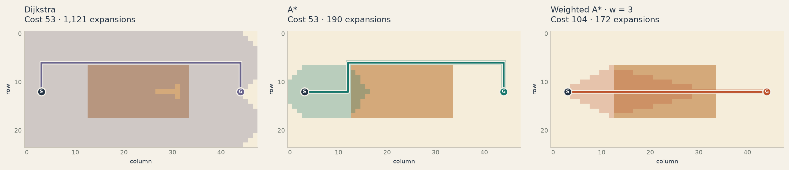

# Grid route planning lab

**[View the report in your browser](https://Michaelhoang8.github.io/grid-route-planning-lab/)**

Dijkstra, A* and weighted A* implemented from source on simulated, positive-cost, four-neighbor grids. The study preserves maps, returned routes, expansion traces and actual repeated measurements, with explicit discrete footprint assumptions.

[Report](docs/report.html) · [Algorithms and assumptions](docs/algorithms.md) · [Methodology](docs/methodology.md) · [Findings](docs/findings.md) · [Trace animation](docs/media/search-expansion.mp4) · [Screenshots](docs/screenshots/README.md) · [Report recording](docs/recordings/README.md)



The terrain-band example demonstrates a cost tradeoff: weighted A* with weight 3 returns cost 104, while Dijkstra and A* return cost 53. On the rooms map, the weighted search reopens cells 151 times. On a one-cell passage, a 3 × 3 discrete footprint changes the answer from reachable to unreachable. These are measured behaviors on owned procedural maps, not physical-robot results.

## Implementation

- Destination-cell terrain costs, positive integers and four orthogonal moves.
- Manhattan distance scaled by minimum free-cell cost for an admissible, consistent A* heuristic.
- Weighted A* with explicit reopening and a model-specific returned-cost bound.
- Deterministic ties, stale heap rejection and immutable route snapshots.
- Integer-scaled priorities preserve ordering without converting large terrain costs to floats.
- Exact square-footprint obstacle inflation that also excludes footprints crossing map boundaries.
- Eight procedural fixtures, 24 saved searches and 120 raw timing observations.

The search code and measurement runner use only the Python standard library. NumPy, Matplotlib and Pillow are used only for figures and trace replay.

## Run and test

Python 3.11 or newer is required. The preserved run and CI use Python 3.13.

```sh
python -m pip install -e .
python -m unittest discover -s tests -v
python scripts/run_study.py --out outputs/my-run
```

The runner creates a new experiment directory and refuses to overwrite a nonempty one. It leaves the committed `results/published/` run intact. Each experiment includes both JSON and CSV maps, JSON path coordinates, CSV expansion traces, raw timings, summaries, environment metadata and a SHA-256 file manifest.

To validate a fresh run instead of the published one:

```sh
# POSIX shell
GRID_RESULTS=outputs/my-run python -m unittest discover -s tests -v
```

```powershell
# PowerShell
$env:GRID_RESULTS = 'outputs/my-run'
python -m unittest discover -s tests -v
Remove-Item Env:GRID_RESULTS
```

## Use the search API

```python
from gridroute import Grid, search, inflate_obstacles

grid = Grid(
    costs=((1, 9, 1), (1, 1, 1)),
    blocked=frozenset(),
    start=(0, 0),
    goal=(0, 2),
)
result = search(grid, algorithm="astar")
assert result.cost == 4
assert result.path == ((0, 0), (1, 0), (1, 1), (1, 2), (0, 2))

weighted = search(grid, algorithm="weighted_astar", weight=3)
inflated = inflate_obstacles(grid, radius=1)
```

Coordinates are `(row, column)`. Starting terrain is not charged; entering each subsequent cell charges that cell's terrain cost. Inflation may block an endpoint or make a map unreachable. Search returns the distinct statuses `found`, `unreachable` and `blocked_endpoint`.

## Preserved results

| Map | Dijkstra cost | A* cost | Weighted A* cost, w = 3 | Weighted / optimal |
| --- | ---: | ---: | ---: | ---: |
| Terrain band | 53 | 53 | 104 | 1.962 |
| Warehouse | 79 | 79 | 79 | 1.000 |
| Rooms | 114 | 114 | 114 | 1.000 |
| Seeded terrain | 71 | 71 | 76 | 1.070 |
| Uniform | 66 | 66 | 66 | 1.000 |
| Narrow passage | 36 | 36 | 36 | 1.000 |
| Narrow passage, radius 1 | Unreachable | Unreachable | Unreachable | — |
| Disconnected | Unreachable | Unreachable | Unreachable | — |

Runtime includes complete in-memory search calls, trace capture and route snapshot construction. Five warmed repetitions are preserved for each configuration. Figures report the median and observed range, not confidence intervals. The supplied maps and tie rule affect expansion counts; neither weighting nor A* is claimed to universally improve runtime.

## Figures and animation

```sh
python -m pip install -r requirements.txt
python scripts/build_report.py
python scripts/render_animation.py
```

The animation additionally requires `ffmpeg` with `libx264` on `PATH`. Its actual encoder and Pillow versions are recorded in `docs/media/animation.json`. Figures and animation are already committed; neither is required to execute or test the algorithms. The replay uses normalized progress within each stored trace, so it must not be interpreted as a wall-clock race.

Open `docs/report.html` in a browser, or run `python -m http.server 8080` from this directory. The report reads the published evidence and does not rerun the timings.

## Validation and scope

The 13-test suite includes an independent Bellman–Ford implementation on 100 seeded grids with five algorithm/weight settings per grid, heuristic admissibility and consistency checks, 140 independent footprint enumerations, legal-route checks, terrain accounting, blocked and unreachable cases, reopened states, stale entries and priorities beyond floating-point range. Evidence tests reconcile the preserved maps, full traces, route coordinates, hashes, counters and timing summaries. The media test verifies the recorded screenshots and browser walkthrough against their capture hashes.

This is an AI-assisted algorithms study using entirely simulated grids. Its clearance rule is an exact discrete square-footprint model, not a continuous collision certificate. The project contains no sensor data, SLAM system, physical robot demonstration, dynamic obstacles, steering constraints, localization uncertainty or production navigation claim.
